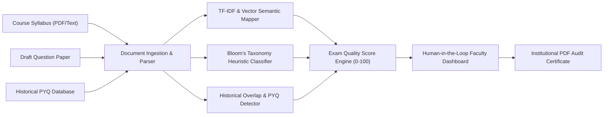

# 📝 ExamLens AI: Examination Quality & Syllabus-Alignment Auditor
### *Semantic Assessment Auditing, Bloom's Taxonomy Cognitive Mapping & Question Paper Moderation*

[](https://fastapi.tiangolo.com)
[](https://www.python.org/)
[](backend/engine/semantic_mapper.py)
[](frontend/)
[](https://github.com/Manas-Jain-24/examlens-ai)

> **ExamLens AI** is an institutional assessment-quality assurance platform engineered for educators, university examination cells, academic moderation committees, and accreditation bodies (NBA, ABET, NAAC). It automates the review of draft examination papers against course syllabi, past exams, and Bloom's Revised Taxonomy.

---

## 📌 Executive Overview & Value Proposition

In higher education, creating balanced examination question papers requires aligning every question with accredited course learning outcomes (COs/LOs), adhering to Bloom's Revised Taxonomy cognitive depths, avoiding question repetition from recent years, and verifying that questions do not test out-of-syllabus concepts.

Manual moderation by academic committees is slow, subjective, and prone to oversight. **ExamLens AI automates this audit through a transparent, explainable pipeline:**



---

## ⚡ Core Capabilities

1. **Automated Syllabus & CO Ingestion**: Extracts units, topics, subtopics, and Course Outcomes (COs) from university syllabi with hierarchical parsing.
2. **Syllabus-to-Question Alignment**: Employs TF-IDF word n-grams combined with cosine similarity and keyword boosting to map each question to its corresponding syllabus module.
3. **Bloom's Revised Taxonomy Classification**: Parses action verbs and cognitive depth ontology across all six cognitive tiers (*Remember*, *Understand*, *Apply*, *Analyze*, *Evaluate*, *Create*), flagging rote-learning bias.
4. **Historical Repetition & Plagiarism Detection**: Analyzes previous-year questions (PYQs), flagging exact repeats ($>85\%$ similarity) and conceptual clones ($>70\%$ similarity).
5. **Mark-Weightage Balance Analysis**: Compares unit marks against recommended percentages, defaulting to equal unit weights when none are provided.
6. **Out-of-Syllabus Anomaly Detection**: Highlights concepts with low semantic proximity to approved syllabus nodes.
7. **Transparent Exam Quality Score (0–100)** with configurable weights (defaults below):
   $$\text{Score} = 0.25 S_{\text{coverage}} + 0.20 S_{\text{outcomes}} + 0.20 S_{\text{marks}} + 0.15 S_{\text{blooms}} + 0.10 S_{\text{in-syllabus}} + 0.10 S_{\text{non-repeat}}$$
8. **Human-in-the-Loop Faculty Override**: Allows faculty to review, adjust, or reclassify question mappings with instantaneous score recalculation.
9. **PDF Audit Export**: Generates a downloadable report with coverage, scores, and moderation findings.

---

## 🚀 1-Click Quickstart

### Prerequisites
- Python 3.10+
- Modern Web Browser

### 1. Installation & Launch
```bash
git clone https://github.com/Manas-Jain-24/examlens-ai.git
cd examlens-ai

# Create virtual environment
python -m venv .venv
# On Windows:
.\.venv\Scripts\activate
# On Linux/macOS:
# source .venv/bin/activate

# Install dependencies
pip install -r requirements.txt

# Launch application (starts FastAPI and automatically opens browser)
python run.py
```
Open `http://127.0.0.1:8000` in your browser.

### 2. Immediate Testing (CS201 Demo)
Click **"Load CS201 Demo"** on the dashboard to test an authentic computer science final exam with pre-seeded moderation flags:
- Missing Unit 4 Graph Algorithms.
- Disproportionate Unit 1 representation.
- Repeat question from the 2025 examination.
- Out-of-syllabus red-black tree question.

---

## 📂 Repository Contents

```text
Project_2/
├── backend/
│   ├── app.py                      # FastAPI REST service & middleware
│   ├── models.py                   # Pydantic schemas & response contracts
│   ├── engine/
│   │   ├── auditor.py              # Composite exam quality scoring engine
│   │   ├── blooms_classifier.py    # Bloom's taxonomy verb ontology & heuristics
│   │   ├── semantic_mapper.py      # TF-IDF unit/outcome semantic mapper
│   │   ├── similarity_detector.py  # Historical PYQ overlap detector
│   │   ├── parsers.py              # PDF/text ingestion & regex tokenizers
│   │   └── pdf_generator.py        # ReportLab institutional PDF audit generator
│   └── data/                       # Pre-loaded CS201 course materials & demo exams
├── frontend/
│   ├── index.html                  # Review dashboard interface
│   ├── styles.css                  # Clean institutional design system
│   └── app.js                      # Chart.js radar & bar visualizations
├── run.py                          # One-click launch automation script
├── requirements.txt                # Runtime dependency minimum versions
├── requirements-dev.txt            # Test HTTP stack versions
├── tests/                          # Backend and frontend regression tests
└── README.md                       # Project documentation
```

---

## Configuration and testing

Copy `.env.example` to `.env` for local configuration. The dashboard is served by
the API, so no separate frontend server is needed. `CORS_ORIGINS` is a
comma-separated list of permitted browser origins; set your frontend URL when
deploying. Uploads accept PDF and UTF-8 `.txt` files. Scanned PDFs require OCR
before upload.

```bash
python -m pip install -r requirements-dev.txt
python -m unittest discover -v
node --test tests/frontend.test.cjs
```

Node.js 22 is used in CI for the frontend tests; the application itself does not
require Node.js. GitHub Actions runs both suites on pushes and pull requests.
AI API tests force deterministic fallback mode and never call a paid service.

Reports retain the original syllabus and previous-year questions for subsequent
recalculations. Added and rewritten questions are re-audited on the server before
new scores are calculated. Faculty unit/Bloom overrides are preserved for other
questions.

## Review, revision history, and evaluation

1. Choose **Audit New Paper**, upload or paste documents, then select **Preview &
   Correct Documents**. Review original extracted text, edit syllabus units and
   outcomes, and correct question IDs, sections, statements, marks, and past papers.
2. Review detected **OR** / **attempt any N** groups. Add or remove groups as
   needed. Groups use question IDs and cannot overlap. The dashboard reports
   expected attempt marks and exact minimum/maximum bounds. Expected distributions
   assume uniform choice; the coverage score counts only guaranteed units.
3. In **Review documents & rules**, set unit weights, the six score component
   weights, desired Bloom percentages, and medium/high repetition thresholds.
   Each percentage distribution must total 100. Rules are retained in reports,
   saved revisions, recalculations, and PDF exports.
4. Expand **Why this mapping? / Faculty review** on a question to inspect matching
   topics, similarity values, candidate units, and the detected Bloom verb. Record
   an accepted/corrected/rejected decision, correct units/Bloom levels or the
   out-of-syllabus flag, add a reason, then click **Recalculate**. Rejection records
   a review decision; it does not remove the question from the paper.
5. Enter an audit title and revision note, then **Save revision**. **Audit history**
   reopens any revision and compares questions, scores, rules, syllabus changes,
   and resolved/new/updated findings. Old revisions cannot be overwritten; saving
   from a stale revision returns a conflict. Use **Save as new audit** for a copy.
6. **Evaluate accuracy** manages reference examples and their reviewer attribution.
   Three initial examples are explicitly unreviewed drafts. Run a draft smoke
   check to exercise the pipeline, or evaluate only reviewed examples. With no
   reviewed examples, reviewed accuracy is shown as unavailable. Export the
   dataset for offline use:

   ```bash
   python -m backend.evaluation --include-drafts
   python -m backend.evaluation --dataset your-reviewed-examples.json
   ```

History and locally edited evaluation examples are stored in
`.data/examlens.sqlite3` (override with `HISTORY_DB_PATH`). Back up that file to
preserve your work. Documents and notes remain on the server; the database and
local QA outputs are ignored by Git. There is no account isolation, so run this
version locally or behind an authenticated service.

See [scoring and choice accounting](docs/SCORING.md) and
[evaluation methodology](docs/EVALUATION.md) for definitions and limitations.

## Current limitations

This is a prototype for faculty review. TF-IDF mapping, verb-based Bloom labels,
and the scoring defaults have not been validated as an institutional quality
standard. Similarity scores are heuristic values, not calibrated probabilities.
Reports and AI summaries do not certify NBA, NAAC, or ABET compliance.

The optional Gemini service uses `GEMINI_API_KEY`; without a key it returns
template-based suggestions. Live provider calls are not covered by the offline
tests. Parsing is best suited to structured English text. Scans require OCR;
complex layouts, unnumbered subparts, and nested choices require manual correction.
The choice model supports disjoint groups, not arbitrary nested examination rules.
There is no login or multi-user access control yet. Initial evaluation samples
are not evidence of faculty-validated accuracy.
